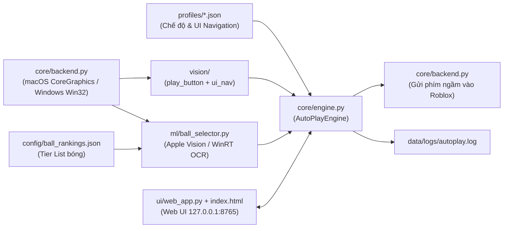

# Kiến Trúc & Cấu Trúc Dự Án — `roblox-ball-autoplay`

Tài liệu này mô tả cấu trúc thư mục thực tế, kiến trúc đa nền tảng (**macOS & Windows**), thiết kế từng module và lộ trình phát triển tiếp theo của dự án **Roblox Ball Autoplay**.

---

## 1. Cấu trúc thư mục hiện tại

```text
roblox-ball-autoplay/
├── README.md                       # Hướng dẫn sử dụng nhanh (make ui trên macOS / python app.py trên Windows)
├── ARCHITECTURE.md                 # Tài liệu kiến trúc & quản lý dự án (file này)
├── CONTRIBUTING.md                 # Quy tắc Conventional Commits & quản lý Git
├── Makefile                        # Các lệnh shortcut trên macOS (make ui, make ranked, make test...)
├── pyproject.toml                  # Metadata & entrypoint gói Python
├── requirements.txt                # Dependencies gọn nhẹ (numpy, Pillow) cho cả macOS & Windows
├── app.py                          # Entrypoint mở nhanh giao diện Web UI (`python3 app.py`)
├── autoplay.py                     # Entrypoint chạy chế độ CLI (`python3 autoplay.py`)
│
├── config/                         # Dữ liệu cấu hình game dùng chung
│   └── ball_rankings.json          # Bảng xếp hạng Tier List (S/A/B/C) & điểm ưu tiên từng trái bóng
│
├── profiles/                       # Cấu hình từng chế độ treo (1 file JSON = 1 chế độ)
│   ├── schema.json                 # JSON Schema chuẩn để validate các file profile
│   ├── default_play.json           # Chế độ thường ở Lobby (nhận diện nút Play xanh -> 2 bước popup)
│   ├── ranked.json                 # Chế độ Ranked (Play Again Game Result + Spectating + Ban/Pick OCR)
│   └── timer_fullscreen.json       # Chế độ Timer không chụp màn hình (chạy xuyên Fullscreen / Space khác)
│
├── docs/
│   └── assets/                     # Ảnh động GIF minh họa cho README (ui_demo, lobby_demo, roblox_demo)
│
├── src/
│   └── roblox_autoplay/
│       ├── __init__.py
│       ├── cli.py                  # Giao diện dòng lệnh (--profile, --list-profiles, --test-ball-ocr...)
│       │
│       ├── core/                   # Tầng hệ điều hành (macOS/Windows) & vòng lặp điều khiển
│       │   ├── backend.py          # Bộ điều phối đa nền tảng (tự chọn macOS CoreGraphics hoặc Windows Win32)
│       │   ├── permissions.py      # Kiểm tra quyền Accessibility & Screen Recording (macOS)
│       │   ├── macos_window.py     # Tìm PID, CGWindowID (bỏ cửa sổ ẩn 500x500), chụp ngầm screencapture
│       │   ├── macos_input.py      # Gửi phím ngầm trực tiếp vào PID qua CGEventPostToPid + jitter
│       │   ├── win_window.py       # Tìm RobloxPlayerBeta.exe, chụp PrintWindow, chống Sleep Win32
│       │   ├── win_input.py        # Gửi phím ngầm vào HWND qua PostMessageW (VK + scan code)
│       │   ├── profile_loader.py   # Đọc, validate và lưu file JSON trong profiles/
│       │   ├── anti_afk.py         # Module chống AFK (hiện tắt mặc định trong các profile)
│       │   └── engine.py           # AutoPlayEngine (State Machine, Ban/Pick OCR, tự đồng bộ UI Nav, file log)
│       │
│       ├── vision/                 # Nhận diện hình ảnh từ cửa sổ game
│       │   ├── play_button.py      # Nhận diện nút Play / Play Again theo ROI, màu xanh & chữ trắng
│       │   └── ui_nav.py           # Nhận diện khung sáng UI Navigation ở nút Sticker góc dưới phải
│       │
│       ├── ml/                     # Nhận diện OCR, xếp hạng & chọn bóng tự động
│       │   └── ball_selector.py    # Apple Vision OCR (biên dịch swiftc -O) + Windows WinRT OCR + Ban/Pick parser
│       │
│       └── ui/                     # Giao diện Web UI cục bộ (không cần thư viện GUI ngoài)
│           ├── web_app.py          # ThreadingHTTPServer localhost (127.0.0.1:8765) + AppController
│           ├── static/
│           │   └── index.html      # Giao diện kính mờ dạt 2 bên, chọn chế độ, chỉnh profile & xem log
│           └── assets/             # Ảnh nền avatar (ui_background.jpg) và banner
│
├── scripts/                        # Script tiện ích phục vụ test & dò giao diện
│   ├── test_bg_key.py              # Script kiểm tra nhanh gửi phím ngầm cơ bản
│   └── ui_explorer.py              # Chụp liên tục 1 round (`watch`) & dò từng phím UI Navigation (`nav`)
│
├── data/                           # (Gitignored) Log phiên chạy (data/logs/autoplay.log) & ảnh explore
└── tests/
    └── test_core.py                # Bộ 18 unit tests (profile, vision, UI Nav, OCR Ban/Pick, Windows VK)
```

---

## 2. Luồng hoạt động tổng thể



---

## 3. Quản lý nhiều chế độ treo bằng `profiles/*.json`

Mỗi chế độ treo là 1 file JSON độc lập trong `profiles/` (validate theo [profiles/schema.json](profiles/schema.json)):
- **`detector`**: chọn giữa `green_play_button` (nhận diện theo vùng `roi` tương đối, không phụ thuộc kích thước cửa sổ) hoặc `timer` (chạy định kỳ không cần chụp màn hình).
- **`extra_triggers`**: hỗ trợ nhiều vị trí nút trong cùng 1 chế độ, mỗi vị trí có thể gắn chuỗi phím riêng (ví dụ trong `ranked.json`: nút `Play Again` ở *Game Result* dùng `\` → `↓` ×9 → `Enter`, còn ở *Spectating* góc dưới trái dùng `\` → `←` → `Enter`).
- **`ball_selection`**: bật/tắt OCR tự động **Ban bóng mạnh nhất của đối thủ** (`ban_slot_sequences`: 3 ô `0/1/2`) và **Pick bóng mạnh nhất của bạn** (`pick_slot_sequences`: 2 ô `0/1`), kèm cơ chế tự kiểm tra trạng thái UI Navigation qua `vision/ui_nav.py` để tránh ngược bật/tắt phím `\`.

---

## 4. Kiến trúc đa nền tảng (`core/backend.py` & `ml/ball_selector.py`)

| Thành phần | macOS (`darwin`) | Windows 10/11 (`win32`) |
| :--- | :--- | :--- |
| **Tìm cửa sổ & Chụp ngầm** | `CGWindowListCopyWindowInfo` + `screencapture -l` (`macos_window.py`) | `EnumWindows` + `PrintWindow(PW_RENDERFULLCONTENT)` (`win_window.py`) |
| **Gửi phím ngầm** | `CGEventPostToPid` (`macos_input.py`) | `PostMessageW` (`WM_KEYDOWN`/`WM_KEYUP` + scan code) (`win_input.py`) |
| **Chống Sleep / Khóa màn** | `caffeinate -di` (qua `Makefile`) | `SetThreadExecutionState` tự động trong `engine.py` |
| **OCR Ban/Pick bóng** | Apple Vision (`swiftc -O` biên dịch cache ~0.28s/lần) | Windows WinRT OCR (`Windows.Media.Ocr.OcrEngine`) |
| **Giao diện điều khiển** | Web UI cục bộ (`make ui`) | Web UI cục bộ (`python app.py`) |

---

## 5. Lộ trình phát triển (Roadmap)

| Phase | Mục tiêu chính | Trạng thái |
| :--- | :--- | :--- |
| **Phase 1** | Core gửi phím ngầm + nhận diện nút `Play` chạy nền trên macOS | ✅ Hoàn thành |
| **Phase 2** | Refactor sang `src/`, quản lý nhiều chế độ `profiles/*.json`, `Makefile` & unit test | ✅ Hoàn thành |
| **Phase 3** | Giao diện Web UI kính mờ chọn chế độ, chỉnh profile, xem log realtime & hỗ trợ Windows | ✅ Hoàn thành |
| **Phase 4a** | OCR gốc đọc màn hình Ranked + bảng Tier List tự động **Ban & Pick bóng** + tự đồng bộ UI Nav | ✅ Hoàn thành |
| **Phase 4b (Tiếp theo)** | Tự đọc màn hình *Game Result* ghi log Win/Loss vào `data/match_logs.jsonl` để tự học & cập nhật điểm bóng theo tài khoản + tự Reconnect khi mất mạng | ⏳ Đang mở rộng |
