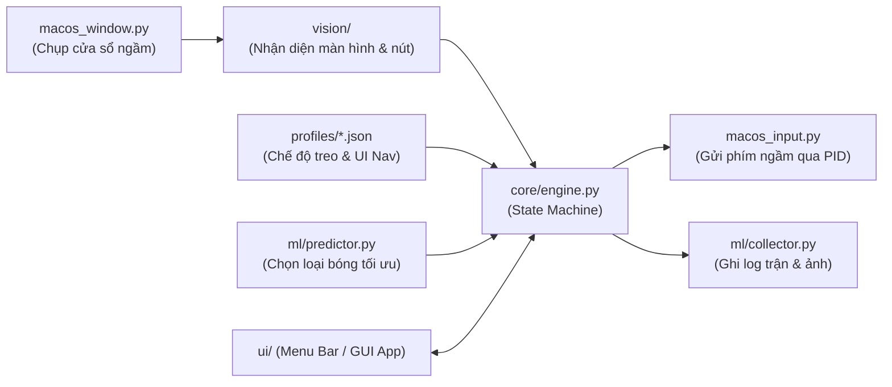

# Kiến Trúc & Cấu Trúc Dự Án — `roblox-ball-autoplay`

Tài liệu này định nghĩa cấu trúc thư mục, phân tách module và lộ trình mở rộng cho dự án **Roblox Ball Autoplay** trên macOS, nhằm đảm bảo dễ bảo trì khi phát triển lên:
1. **Nhiều chế độ treo máy** (mỗi chế độ có chuỗi UI Navigation & điều kiện nhận diện riêng).
2. **Đóng gói thành macOS App có giao diện (GUI / Menu Bar)** để bật/tắt nhanh.
3. **Module Machine Learning (ML)** tự động thu thập dữ liệu, train và chọn loại bóng phù hợp nhất.

---

## 1. Cấu trúc thư mục đề xuất

```text
roblox-ball-autoplay/
├── README.md                       # Hướng dẫn cài đặt, cấp quyền macOS và sử dụng nhanh
├── ARCHITECTURE.md                 # Tài liệu kiến trúc & quản lý dự án (file này)
├── pyproject.toml                  # Quản lý dependencies, metadata, entrypoint CLI/App
│
├── profiles/                       # Cấu hình từng chế độ treo (1 file = 1 chế độ)
│   ├── schema.json                 # Schema chuẩn để validate các file profile
│   ├── default_play.json           # Chế độ hiện tại (\ -> Down x3 -> Right -> Enter -> Popup -> \)
│   ├── ranked_mode.json            # Ví dụ: chế độ treo Ranked
│   └── event_farm.json             # Ví dụ: chế độ treo Event
│
├── src/
│   └── roblox_autoplay/
│       ├── __init__.py
│       ├── cli.py                  # Entrypoint dòng lệnh (chạy theo profile, test-keys, check-once)
│       │
│       ├── core/                   # Tầng hệ điều hành macOS & vòng lặp điều khiển
│       │   ├── permissions.py      # Kiểm tra quyền Accessibility & Screen Recording
│       │   ├── macos_window.py     # Tìm PID, CGWindowID, chụp cửa sổ ngầm (screencapture)
│       │   ├── macos_input.py      # Gửi phím ngầm qua CGEventPostToPid + human jitter
│       │   ├── profile_loader.py   # Đọc & validate file JSON trong thư mục profiles/
│       │   ├── anti_afk.py         # Logic chống kick AFK 20 phút
│       │   └── engine.py           # Vòng lặp chính (State Machine: IDLE -> LOBBY -> IN_MATCH)
│       │
│       ├── vision/                 # Nhận diện hình ảnh từ cửa sổ game
│       │   ├── play_button.py      # Nhận diện nút Play (màu + hình học + chữ trắng)
│       │   ├── screen_state.py     # Phân loại trạng thái màn hình (Lobby / Popup / In-Match / Result)
│       │   └── ball_detector.py    # Cắt ROI & nhận diện các loại bóng đang có trên màn hình
│       │
│       ├── ml/                     # Pipeline dữ liệu & train model chọn loại bóng
│       │   ├── collector.py        # Tự động lưu ảnh + log kết quả trận (win/loss, map, bóng đã chọn)
│       │   ├── dataset.py          # Tiền xử lý, gán nhãn, chia train/val
│       │   ├── train_selector.py   # Huấn luyện model dự đoán loại bóng tối ưu
│       │   └── predictor.py        # Load model đã train để gợi ý / tự chọn bóng lúc chạy thật
│       │
│       └── ui/                     # Giao diện người dùng & đóng gói macOS App
│           ├── menubar_app.py      # App chạy trên thanh Menu Bar macOS (bật/tắt, chọn mode nhanh)
│           ├── settings_window.py  # Cửa sổ cài đặt profile, xem log realtime, test nhận diện
│           └── assets/             # Icon app (.icns), hình minh họa
│
├── data/                           # (Gitignored) Dữ liệu thu thập phục vụ train & debug
│   ├── raw/                        # Ảnh chụp thô theo từng phiên chơi
│   ├── labeled/                    # Ảnh đã phân loại theo tên bóng / trạng thái màn hình
│   └── match_logs.jsonl            # Nhật ký từng trận (thời gian, mode, bóng chọn, kết quả)
│
├── models/                         # (Gitignored hoặc Git LFS) Trọng số model đã train
│   └── ball_selector_v1.onnx       # Model nhẹ để inference nhanh trên CPU/Apple Silicon
│
├── scripts/                        # Script tiện ích (test nhanh, build .app)
│   ├── test_bg_key.py              # Script test gửi phím ngầm cơ bản (hiện có)
│   └── build_macos_app.sh          # Đóng gói thành RobloxAutoplay.app
│
└── tests/                          # Unit test (test detector trên ảnh mẫu, test parser profile)
    ├── fixtures/                   # Ảnh màn hình mẫu (lobby, popup, in-match)
    └── test_play_button.py
```

> **Hiện trạng hiện tại:** Dự án đã hoàn thành **Phase 2** — tách toàn bộ code vào `src/roblox_autoplay/`, quản lý nhiều chế độ qua `profiles/*.json`, có bộ unit test trong `tests/`, và sẵn sàng bước sang **Phase 3 (Menu Bar / GUI App)**.

---

## 2. Luồng hoạt động tổng thể



---

## 3. Quản lý nhiều chế độ treo bằng `profiles/*.json`

Thay vì hardcode phím bấm trong Python, **mỗi chế độ treo sẽ là 1 file JSON riêng**. Khi game đổi UI hoặc bạn muốn thêm chế độ mới, chỉ cần tạo/sửa file JSON mà không đụng vào code core.

Ví dụ `profiles/default_play.json`:

```json
{
  "id": "default_play",
  "name": "Chế độ mặc định (Play + Popup)",
  "detector": {
    "type": "green_play_button",
    "roi": [0.30, 0.84, 0.70, 0.995],
    "min_green_ratio": 0.60
  },
  "timing": {
    "scan_interval_sec": 3.0,
    "cooldown_sec": 12.0,
    "step_delay_sec": 0.22
  },
  "sequence": [
    "backslash",
    "down", "down", "down", "right", "enter",
    "wait:0.8",
    "down", "enter",
    "wait:0.3",
    "backslash"
  ],
  "anti_afk": {
    "enabled": true,
    "interval_sec": 480,
    "key": "space"
  },
  "ball_selection": {
    "enabled": false,
    "strategy": "fixed",
    "model_path": null
  }
}
```

---

## 4. Thiết kế phần App có giao diện (macOS)

Vì tool chạy ngầm trên macOS và cần thao tác nhanh trong lúc làm việc, thiết kế gọn nhẹ nhất gồm:

- **Menu Bar App** (biểu tượng nhỏ trên thanh trên cùng của macOS):
  - Hiển thị trạng thái nhanh: `Đang chạy (12 trận)` / `Đang dừng` / `Chờ Roblox`.
  - Chọn nhanh **Chế độ treo** (tự động liệt kê các file trong `profiles/`).
  - Nút **Start / Pause**, **Test phím**, **Mở cửa sổ Cài đặt & Log**.
- **Công nghệ gợi ý:**
  - *Nhanh & đồng bộ 100% Python:* `rumps` (Menu Bar) + `PySide6` hoặc `CustomTkinter` (cửa sổ Settings/Profile editor), đóng gói `.app` bằng `py2app` hoặc `PyInstaller`.
  - *Đẹp chuẩn native macOS:* SwiftUI làm vỏ giao diện + gọi Python engine chạy nền qua IPC/stdout.
- **Lưu ý bảo mật macOS khi đóng gói `.app`:** Cần ký cục bộ (`codesign --deep --force -s -`) để macOS nhớ quyền **Accessibility** và **Screen Recording** cho app thay vì hỏi lại mỗi lần cập nhật.

---

## 5. Thiết kế phần Train & Chọn loại bóng (`ml/`)

Bài toán chọn loại bóng phù hợp nên chia thành **2 lớp độc lập** để dễ train và đạt độ chính xác cao:

1. **Lớp 1 — Nhận diện ngữ cảnh (Computer Vision):**
   - Thu thập ảnh từ `collector.py` lúc ở màn hình chọn bóng / vào trận / kết thúc trận.
   - Nhận diện các đặc trưng quan trọng: *bản đồ (map) nào*, *chế độ chơi*, *các loại bóng đang mở khóa/hiển thị*, và *kết quả trận (Win / Lose / Điểm thưởng)*.
2. **Lớp 2 — Chọn loại bóng tối ưu (Decision / Recommendation):**
   - **Bước đầu (Thu thập dữ liệu):** Ghi toàn bộ lịch sử vào `data/match_logs.jsonl` dạng `{timestamp, mode, map, ball_chosen, result, duration}`.
   - **Bước huấn luyện:** Dùng thuật toán phân loại / hồi quy nhẹ (như LightGBM, Random Forest hoặc Contextual Bandit) để dự đoán xác suất thắng / hiệu quả farm của từng loại bóng theo từng ngữ cảnh.
   - **Bước chạy thật:** `predictor.py` đọc trạng thái hiện tại → chọn loại bóng điểm cao nhất → ánh xạ sang chuỗi phím UI Navigation để đổi bóng trước khi bấm `Play`.

---

## 6. Lộ trình phát triển (Roadmap)

| Phase | Mục tiêu chính | Kết quả đạt được |
| :--- | :--- | :--- |
| **Phase 1 (Hiện tại)** | Core chạy ngầm cho 1 chế độ | [autoplay.py](file:///Users/sanghoang211231/Documents/Project/Personal%20Project/roblox-ball-autoplay/autoplay.py) chạy ổn định, bấm đúng chuỗi 2 cửa sổ & tắt UI Nav |
| **Phase 2** | Refactor sang `src/` + hệ thống `profiles/` | Hỗ trợ nhiều chế độ treo khác nhau bằng file JSON, có unit test trên ảnh mẫu |
| **Phase 3** | Xây dựng GUI & đóng gói `.app` | Bật/tắt từ Menu Bar macOS, chọn chế độ, xem số trận & log trực quan |
| **Phase 4** | Thu thập dữ liệu & Train chọn bóng | Tự ghi log thắng/thua theo loại bóng, train model và tự động đổi bóng tối ưu |
