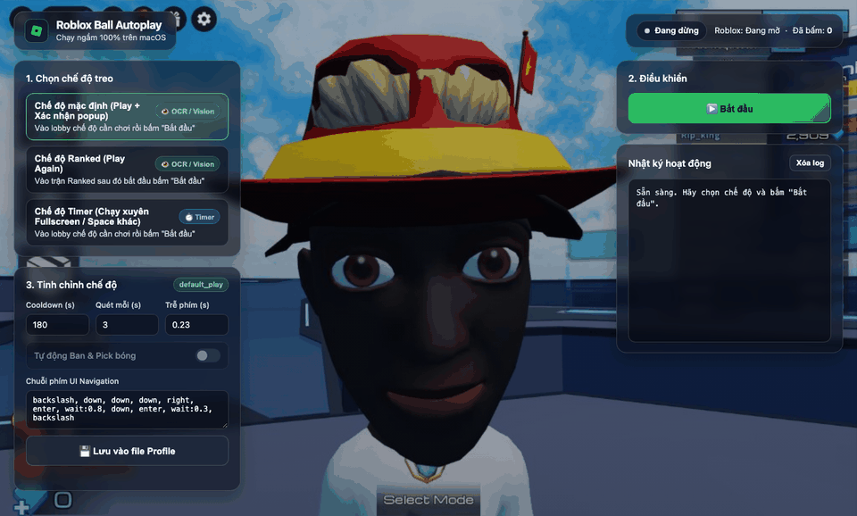
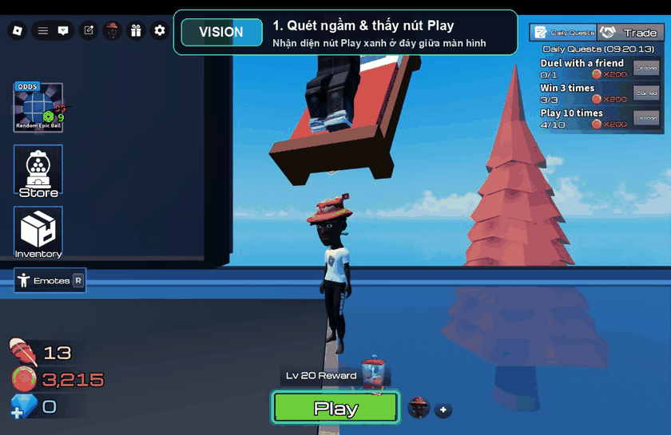

# 🎮 Roblox Ball Autoplay (macOS & Windows)

Tool tự động treo game **Ball VS Ball (Roblox)** **chạy ngầm 100%** trên **macOS và Windows** — không cướp chuột, không nhảy cửa sổ, hỗ trợ tự bấm **Play / Play Again** và tự **Ban & Pick bóng mạnh nhất** trong Ranked bằng OCR gốc của hệ điều hành.



---

## 1. Cách cài đặt & chạy nhanh

### 🍎 Trên macOS
1. **Cấp 2 quyền 1 lần duy nhất:** Mở **System Settings → Privacy & Security** và bật cho **Terminal** (sau đó tắt mở lại Terminal):
   - **Accessibility (Trợ năng)**
   - **Screen & System Audio Recording (Ghi màn hình)**
2. **Mở giao diện điều khiển:**
   ```bash
   make ui
   ```

### 🪟 Trên Windows (10 bản 1809+ / Windows 11)
1. Cài **Python 3.10+** từ [python.org](https://www.python.org/downloads/) *(bắt buộc tích chọn **Add Python to PATH** ở màn hình cài đặt đầu tiên)*.
2. Dùng bản **Roblox Player tải từ trang chủ [roblox.com](https://www.roblox.com/)** *(không dùng bản cài từ Microsoft Store)*.
3. Mở **PowerShell** hoặc **Command Prompt (CMD)** trong thư mục dự án và chạy:
   ```powershell
   pip install -r requirements.txt
   python app.py
   ```

#### Lưu ý riêng cho Windows (tránh lỗi thường gặp)
- **Không thu nhỏ (Minimize) & không bấm `F11` Fullscreen:** Để Roblox ở chế độ cửa sổ bình thường (có thể mở Chrome/Edge che kín đè lên thoải mái, nhưng đừng bấm dấu `-` thu nhỏ xuống Taskbar).
- **Quyền Administrator:** Nếu máy bạn đang mở Roblox bằng *Run as administrator*, hãy mở PowerShell/CMD bằng **Run as administrator**.
- **Bố cục bàn phím:** Nên để layout **English (US)** để phím `\` bật UI Navigation trong Roblox hoạt động đúng.
- **OCR tự Ban & Pick bóng (chế độ Ranked):** Cần có gói ngôn ngữ **English (United States)** trong *Settings → Time & Language → Language* (mặc định Windows 10/11 có sẵn; một số bản Windows rút gọn/LTSC cần cài thêm gói tiếng Anh nếu muốn dùng OCR Ranked).
- **Chống ngủ màn hình:** Tool tự giữ Windows không tự Sleep/tắt màn hình trong lúc đang chạy nút **Bắt đầu**.

---

## 2. Cách dùng giao diện

1. **Chọn chế độ treo** ở cột bên trái:
   - **Chế độ mặc định (Play + Xác nhận popup):** Vào lobby chế độ cần chơi rồi bấm **"Bắt đầu"**.
   - **Chế độ Ranked (Play Again):** Vào trận Ranked sau đó bấm **"Bắt đầu"** *(có thể bật thêm **Tự động Ban & Pick bóng** ở mục 3)*.
   - **Chế độ Timer:** Vào lobby chế độ cần chơi rồi bấm **"Bắt đầu"** *(chạy xuyên Fullscreen / Desktop Space khác vì không cần chụp màn hình)*.
2. *(Tùy chọn)* Chỉnh nhanh **Cooldown**, **Chuỗi phím UI Navigation** ở mục **3** rồi bấm **Lưu vào file Profile**.
3. Bấm **▶️ Bắt đầu** ở cột bên phải — xong bạn có thể mở trình duyệt / ứng dụng khác đè lên làm việc bình thường!

---

## 3. Minh họa hoạt động tự động trong Roblox

### Chế độ thường (tại Lobby)
Khi đứng ở Lobby và bấm **Bắt đầu**, tool tự nhận diện nút **`Play`** màu xanh lá rồi gửi chuỗi phím UI Navigation chạy ngầm (`\` → `↓` ×3 → `→` → `Enter` → xác nhận popup → `\`) mà không cần mở cửa sổ Roblox lên:



### Chế độ Ranked (tự động Ban & Pick bóng)
Trong trận Ranked, tool tự đọc tên bóng bằng OCR, điều khiển khung **UI Navigation** chạy ngầm để **cấm bóng mạnh nhất của đối thủ (BAN)** và **chọn bóng mạnh nhất của bạn (PICK)** rồi xác nhận tự động:


---

## Lưu ý nhỏ khi treo máy
- Với chế độ **Nhận diện nút Play / Ranked**, bạn có thể để trình duyệt/app khác che kín lên cửa sổ Roblox trên **cùng 1 Desktop**, nhưng **không bấm nút thu nhỏ (Minimize)** (và trên macOS không bật Fullscreen nút xanh lá sang Desktop Space khác).
- Muốn tắt hẳn ứng dụng: bấm **⏹️ Dừng** trên giao diện và nhấn `Ctrl + C` trong Terminal / CMD.
- Xem chi tiết kiến trúc dự án tại [ARCHITECTURE.md](ARCHITECTURE.md) và quy tắc commit tại [CONTRIBUTING.md](CONTRIBUTING.md).
