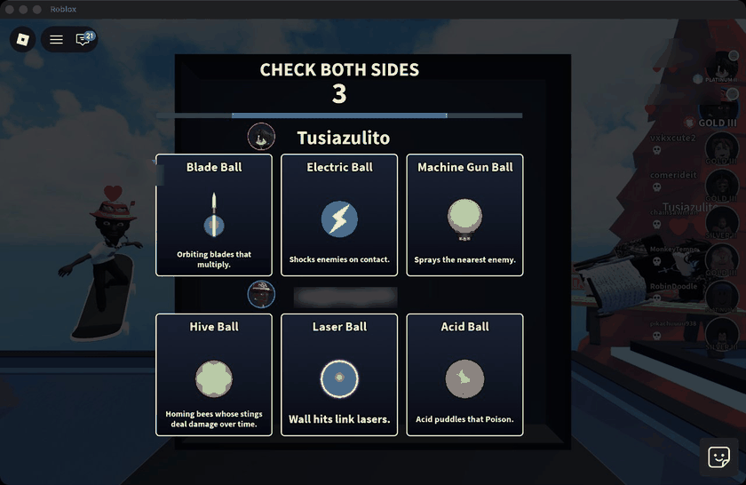

# 🎮 Roblox Ball Autoplay (macOS)

Tool tự động treo game **Ball VS Ball (Roblox)** **chạy ngầm 100%** trên macOS — không cướp chuột, không nhảy cửa sổ, hỗ trợ tự bấm **Play / Play Again** và tự **Ban & Pick bóng mạnh nhất** trong Ranked bằng Apple Vision OCR.


---

## 1. Chuẩn bị 1 lần duy nhất (Cấp quyền macOS)

Mở **System Settings → Privacy & Security** và bật 2 quyền sau cho **Terminal** (sau đó tắt và mở lại Terminal):
1. **Accessibility (Trợ năng)** — để gửi phím ngầm thẳng vào cửa sổ `RobloxPlayer`.
2. **Screen & System Audio Recording (Ghi màn hình)** — để nhận diện nút Play và đọc tên bóng khi cửa sổ Roblox bị app khác che.

---

## 2. Cách sử dụng (chỉ cần 1 lệnh)

Mở **Terminal** trong thư mục dự án và chạy:

```bash
make ui
```

Lệnh này sẽ tự mở giao diện điều khiển trên trình duyệt (kèm tự chống Sleep & khóa màn hình trên macOS):

1. **Chọn chế độ treo** ở cột bên trái:
   - **Chế độ mặc định (Play + Xác nhận popup):** Vào lobby chế độ cần chơi rồi bấm **"Bắt đầu"**.
   - **Chế độ Ranked (Play Again):** Vào trận Ranked sau đó bấm **"Bắt đầu"** *(có thể bật thêm **Tự động Ban & Pick bóng** ở mục 3)*.
   - **Chế độ Timer:** Vào lobby chế độ cần chơi rồi bấm **"Bắt đầu"** *(chạy xuyên Fullscreen / Desktop Space khác vì không cần chụp màn hình)*.
2. *(Tùy chọn)* Chỉnh nhanh **Cooldown**, **Chuỗi phím UI Navigation** ở mục **3** rồi bấm **Lưu vào file Profile**.
3. Bấm **▶️ Bắt đầu** ở cột bên phải — xong bạn có thể chuyển sang Safari / ứng dụng khác làm việc bình thường!

---

## 3. Minh họa hoạt động tự động trong Roblox

### Chế độ thường (tại Lobby)
Khi đứng ở Lobby và bấm **Bắt đầu**, tool tự nhận diện nút **`Play`** màu xanh lá rồi gửi chuỗi phím UI Navigation chạy ngầm (`\` → `↓` ×3 → `→` → `Enter` → xác nhận popup → `\`) mà không cần mở cửa sổ Roblox lên:


### Chế độ Ranked (tự động Ban & Pick bóng)
Trong trận Ranked, tool tự đọc tên bóng bằng Apple Vision OCR, điều khiển khung **UI Navigation** chạy ngầm để **cấm bóng mạnh nhất của đối thủ (BAN)** và **chọn bóng mạnh nhất của bạn (PICK)** rồi xác nhận tự động:



---

## Lưu ý nhỏ khi treo máy (macOS)
- Với chế độ **Nhận diện nút Play / Ranked**, bạn có thể để Safari/Chrome che kín lên cửa sổ Roblox trên **cùng 1 Desktop**, nhưng **không bấm nút vàng Minimize** và **không bật nút xanh lá Fullscreen** sang Desktop Space khác.
- Muốn tắt hẳn ứng dụng: bấm **⏹️ Dừng** trên giao diện và nhấn `Ctrl + C` trong Terminal.

---

## 🪟 Dành cho Windows

> **Trạng thái hiện tại:** Bản hiện tại đang dùng API gốc của **macOS** (`CoreGraphics` gửi phím ngầm, `screencapture` chụp cửa sổ ẩn, `Apple Vision OCR` đọc tên bóng, và `caffeinate` chống Sleep) nên **chỉ chạy trực tiếp trên macOS**.

Nếu bạn muốn cài đặt môi trường để phát triển hoặc sử dụng khi bản hỗ trợ Windows (Win32) được bổ sung:
1. Cài **Python 3.10+** (nhớ tích chọn **Add Python to PATH**).
2. Cài 2 thư viện cần thiết trong PowerShell / Command Prompt:
   ```powershell
   pip install numpy Pillow
   ```
3. Trên Windows không có sẵn lệnh `make` và `caffeinate`, thay vào đó chạy trực tiếp bằng:
   ```powershell
   python app.py
   ```
   *(Lưu ý: Hiện tại chạy lệnh này trên Windows sẽ báo thiếu framework `CoreGraphics` của macOS cho đến khi bổ sung backend Win32 `PostMessage` + `PrintWindow`.)*

---

Xem chi tiết kiến trúc dự án tại [ARCHITECTURE.md](ARCHITECTURE.md) và quy tắc commit tại [CONTRIBUTING.md](CONTRIBUTING.md).
